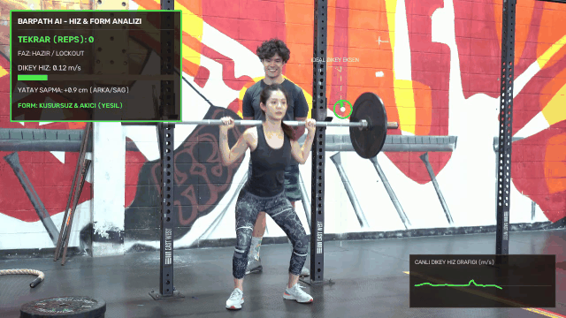
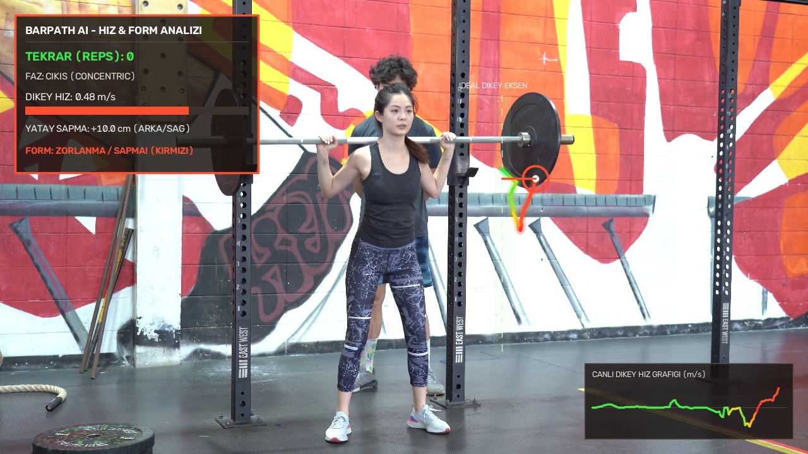
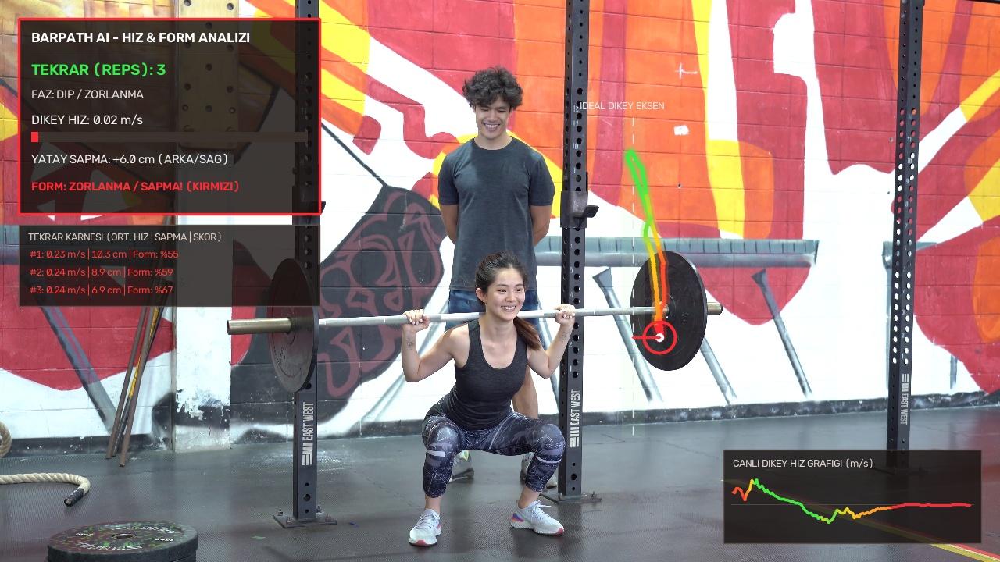
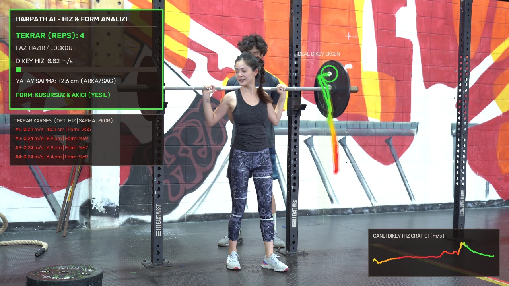

# 🏋️‍♂️ BarPath AI — Halter Bar Yolu (Bar Path), Hız (VBT) ve Form Analiz Sistemi

**BarPath AI**, ağırlık antrenmanlarında (Squat, Deadlift, Bench Press, Olympic Lifts) sporcu verimliliğini artırmak ve sakatlık riskini azaltmak amacıyla barın izlediği dikey yörüngeyi (**Bar Path**), anlık dikey hızı (**Velocity-Based Training - VBT**) ve yatay form sapmalarını yapay zeka ile analiz eden bir bilgisayarlı görü sistemidir.



---

## 🎯 Temel Özellikler

* **🟢🟡🔴 Dinamik Hız ve Form Renklendirmesi:**
  * 🟢 **Yeşil:** Bar hızlı, akıcı ve ideal dikey referans eksenine sadık hareket ederken.
  * 🟡 **Sarı:** Hızın düşmeye başladığı veya dikey hattan hafif yatay sapmaların oluştuğu anlarda.
  * 🔴 **Kırmızı:** Sporcunun zorlandığı (**Sticking Point**) veya barın öne/arkaya ciddi saptığı kritik bölgelerde.
* **🧠 4 Katmanlı Hibrit Takip Mimarisi (`YOLOv8 + Metal Göbek Kilitleme + Optik Akış + Kalman`):**
  * Özel eğitilmiş [`best.pt`](best.pt) YOLOv8 modeli ile bar tespiti yapılır.
  * Kutu esnemelerini (squat rack direklerine takılma) engelleyen **Outlier Filtresi** ve plaka ortasındaki metal göbeği yakalayan **Lokal Parlaklık Kilitlemesi** uygulanır.
  * **9 Noktalı Medyan Pyramidal Lucas-Kanade Optik Akış** ve **Kalman Filtresi** ile titreşimsiz, yayın kalitesinde (Broadcast) pürüzsüz eğri çizilir.
* **📏 Gerçek Fiziksel Kalibrasyon (`m/s` ve `cm`):**
  * Standart olimpik plaka çapı (**45 cm = 0.45 m**) üzerinden otomatik piksel-metre kalibrasyonu yapılarak anlık hız **m/s**, yatay sapma ise **cm** cinsinden hesaplanır.
* **🖥️ İnteraktif Dark Mode Masaüstü Stüdyosu (`app.py`):**
  * Canlı takip noktası değiştirme (**Sağ Plaka Göbeği**, **Bar Tam Ortası**, **Sol Plaka Göbeği**)
  * Farklı kamera açıları için **🎯 Videodan Plakayı Elle Seç (Tıkla-Takip Et)** modu
  * Canlı **Çizgi İzi Uzunluğu**, **Çizgi Kalınlığı** ve **Hız Hassasiyeti** sürgüleri
  * Otomatik **Tekrar Sayacı (Rep Counter)**, **Tekrar Karnesi** ve **Canlı Hız Grafiği (Sparkline)**

---

## 📸 Ekran Görüntüleri

| 1. Tekrar (Akıcı Çıkış) | 4. Tekrar (Sticking Point / Zorlanma) | Set Sonu & Tekrar Karnesi |
| :---: | :---: | :---: |
|  |  |  |

---

## 🚀 Kurulum ve Çalıştırma

### 1. Gereksinimleri Yükleyin
```bash
pip install -r requirements.txt
```

### 2. İnteraktif Masaüstü Stüdyosunu Başlatın (Önerilen)
```bash
python app.py
```

### 3. Komut Satırından Video İşleme ve Kayıt
```bash
python main.py
```

---

## 📁 Proje Yapısı

```text
├── app.py                  # Dark Mode Masaüstü Analiz Stüdyosu (Tkinter + PIL)
├── main.py                 # Çekirdek Hibrit Takip (YOLOv8 + Optik Akış + Kalman) ve HUD Motoru
├── best.pt                 # Eğitilmiş YOLOv8 Barbell Tespit Modeli
├── video.mp4               # Örnek Back Squat Antrenman Videosu
├── output_barpath.mp4      # Analiz Edilmiş Örnek Çıktı Videosu
├── video_detections.json   # Hızlı 45+ FPS Önizleme İçin Önbelleklenmiş Tespit Verisi
├── assets/                 # README Görselleri ve Animasyonlu Demo GIF
└── requirements.txt        # Python Kütüphane Bağımlılıkları
```
